# Telltale Modding Studio

A desktop app for exploring and modding Telltale games. Point it at an installed
game (e.g. *The Walking Dead: The Telltale Definitive Series* or *Tales from the
Borderlands*) and it inventories the whole game: every character with their
outfit parts, textures and animations, and every file in its archives. Swap in
replacements and build a minimal patch archive the game loads over its originals.

Archives are read natively (`.ttarch2`: chunked zlib/Oodle, Blowfish-encrypted or
plain). [ttarchext](https://aluigi.altervista.org/papers.htm#ttarchext) by Luigi
Auriemma (for learning purposes only) is still used to build patches, to decrypt
the games' resource descriptions, and to read classic `.ttarch` archives.

**Download:** Windows and Linux (x86-64) builds are on the [Releases](../../releases) page.

- **Windows:** unzip it and run `TelltaleModding.App.exe`; keep the `engine` folder next to it.
- **Linux:** extract the `.tar.gz` and run `TelltaleModding.App`; keep the `engine` folder and
  `libtelltale_oodle.so` next to it. Games installed through Steam (including Flatpak and
  Snap Steam) are found like on Windows.

Each release lists SHA-256 checksums in `SHA256SUMS.txt`, and releases built by CI can be
checked with `gh attestation verify <file> --repo infernokun/TelltaleModdingStudio`.

## Screenshots

Click a picture for the full size.

<table>
  <tr>
    <td align="center" width="33%"><a href="docs/screenshots/characters.png">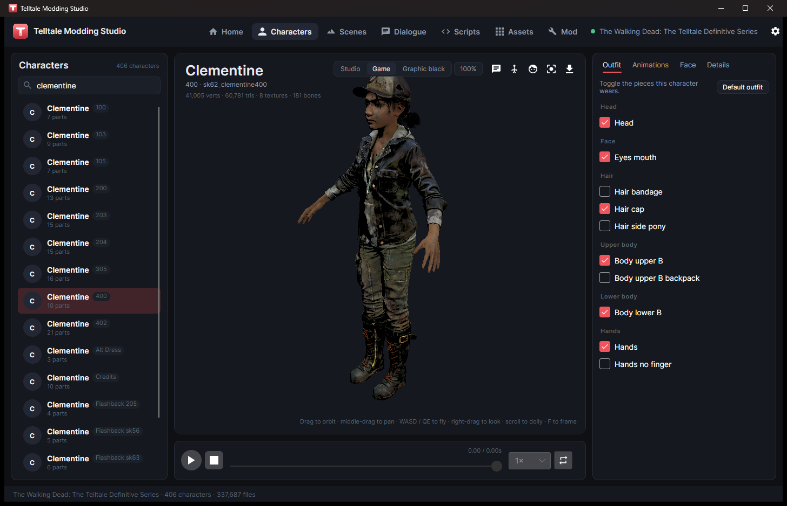</a><br><sub>Characters: outfits and the game's look (Clementine)</sub></td>
    <td align="center" width="33%"><a href="docs/screenshots/animations.png">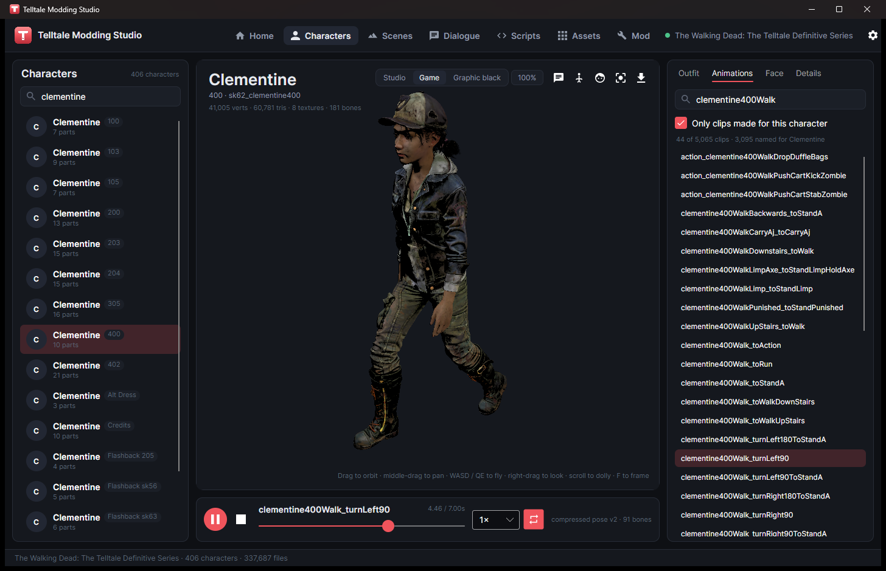</a><br><sub>Animations played on the model</sub></td>
    <td align="center" width="33%"><a href="docs/screenshots/face.png">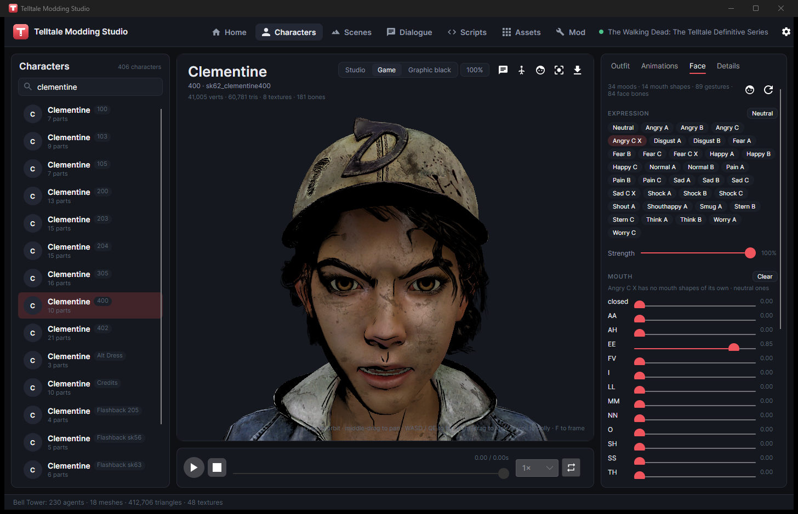</a><br><sub>Face tab: moods, mouth shapes, gestures</sub></td>
  </tr>
  <tr>
    <td align="center" width="33%"><a href="docs/screenshots/characters_tftb.png">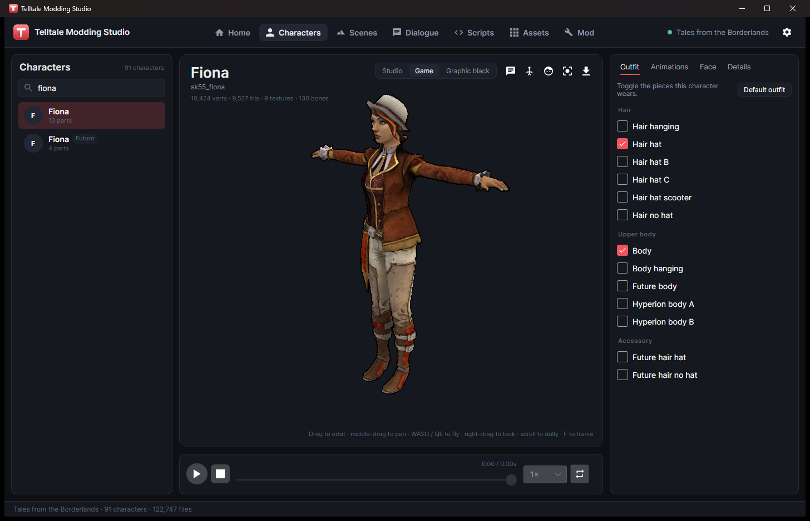</a><br><sub>Fiona, Tales from the Borderlands</sub></td>
    <td align="center" width="33%"><a href="docs/screenshots/characters_got.png">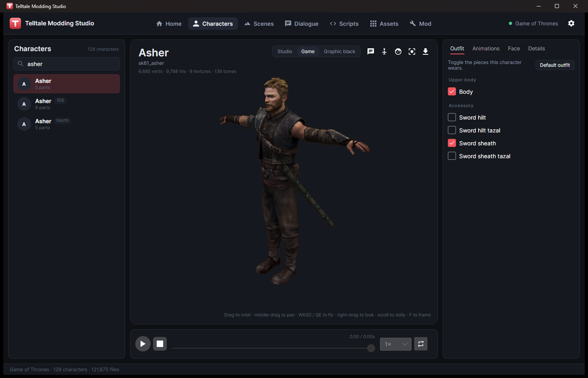</a><br><sub>Asher, Game of Thrones</sub></td>
    <td align="center" width="33%"><a href="docs/screenshots/characters_wau.png">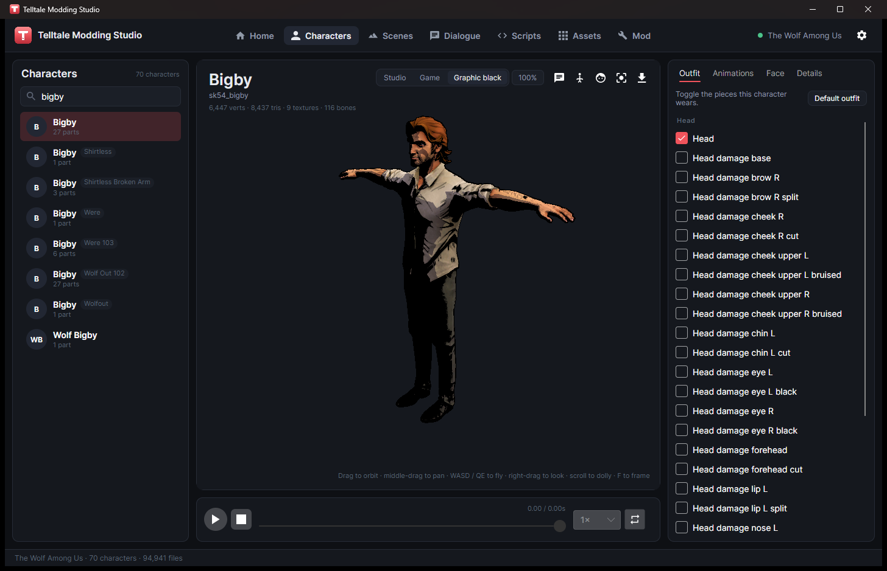</a><br><sub>Bigby in the Graphic black look</sub></td>
  </tr>
  <tr>
    <td align="center" width="33%"><a href="docs/screenshots/dialogue.png">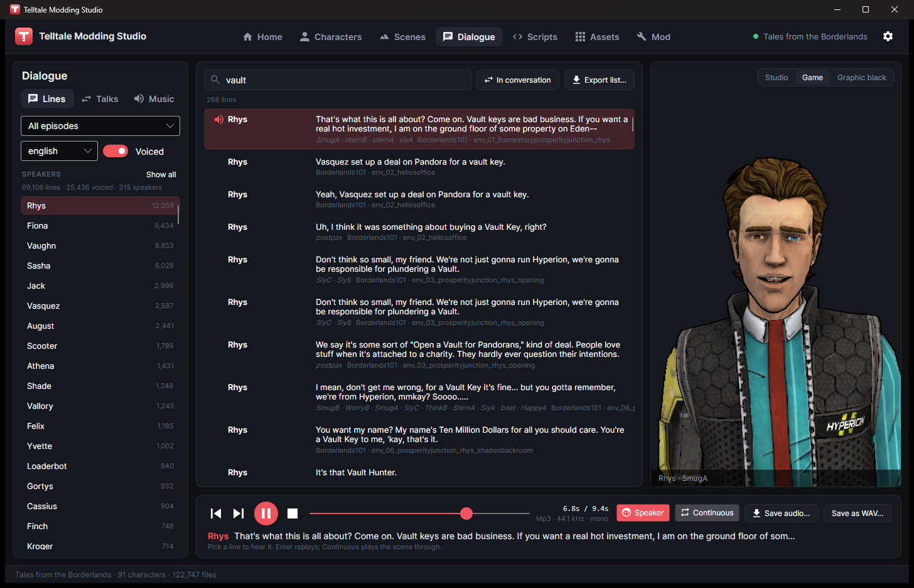</a><br><sub>Dialogue with a lip-synced 3D speaker</sub></td>
    <td align="center" width="33%"><a href="docs/screenshots/conversation.png">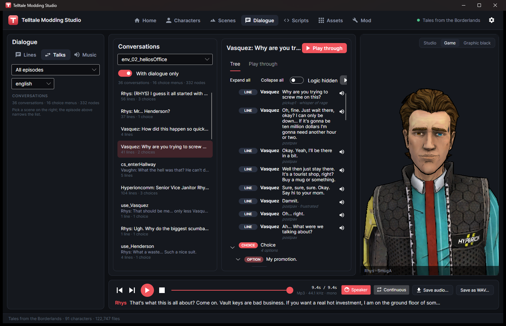</a><br><sub>Conversation trees (Talks)</sub></td>
    <td align="center" width="33%"><a href="docs/screenshots/scenes.png">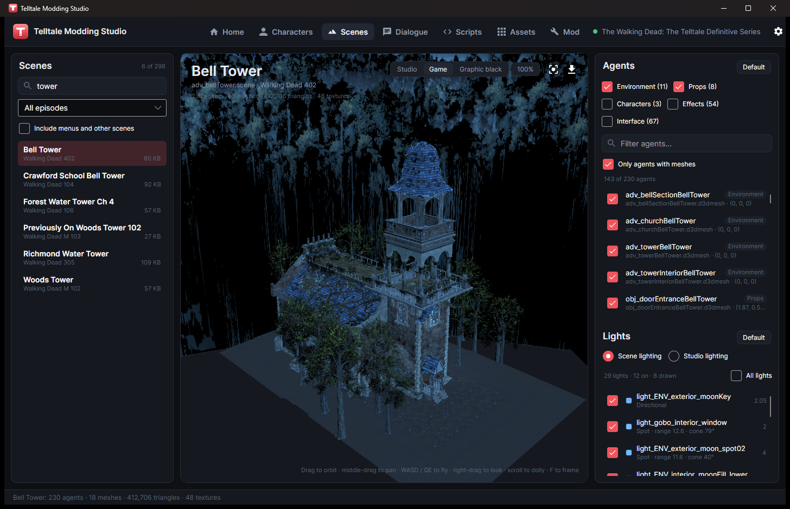</a><br><sub>Scenes rebuilt with their own lights</sub></td>
  </tr>
  <tr>
    <td align="center" width="33%"><a href="docs/screenshots/scripts.png">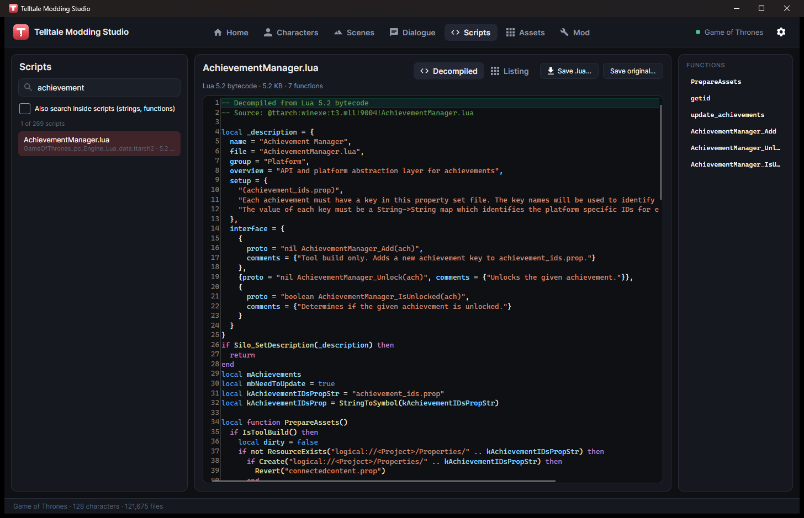</a><br><sub>Decompiled Lua scripts</sub></td>
    <td align="center" width="33%"><a href="docs/screenshots/assets.png">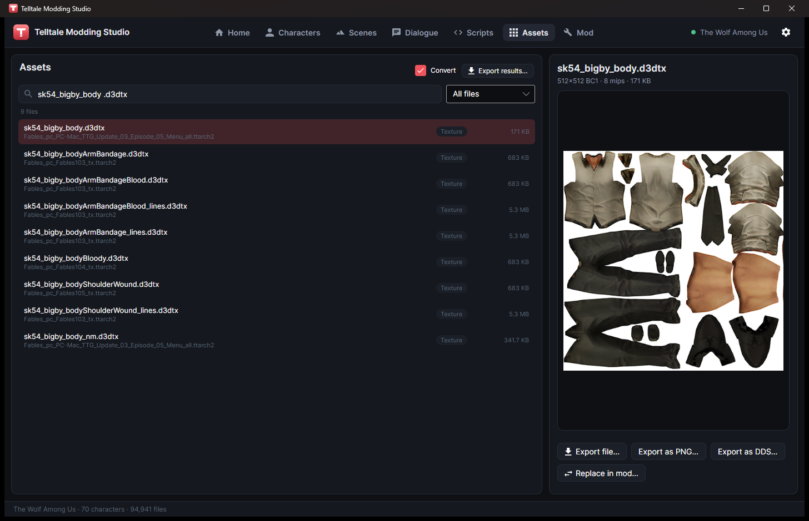</a><br><sub>Asset browser and texture preview</sub></td>
    <td align="center" width="33%"><a href="docs/screenshots/home.png">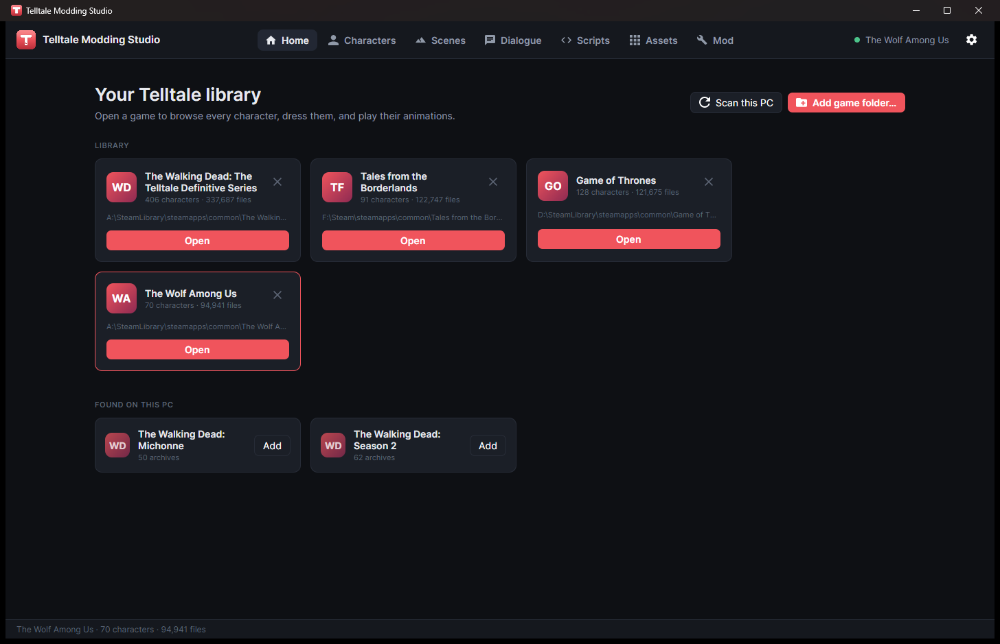</a><br><sub>Game library</sub></td>
  </tr>
</table>

## Features

- **Home**: add your installed Telltale games (or let it find them in Steam).
- **Characters**: every character with their outfits, animations and facial
  expressions. Export to `.glb` for Blender.
- **Scenes**: walk around any location in the game, lit like the game.
- **Dialogue**: read and hear every line, watch the character lip-sync it, and
  follow conversations as dialogue trees. Includes the soundtrack.
- **Scripts**: the game's Lua scripts, decompiled and readable.
- **Assets**: browse, preview and export any file (PNG, WAV, MP3/Ogg, Lua).
- **Mod**: swap in your own files and build a small patch the game loads.

**Viewport controls:** drag to orbit, middle-drag to pan, scroll to zoom, **F** to
frame. Click the view and use **WASD/QE** to fly; hold right-click to look around.

**Looks:** *Studio* for plain lighting, *Game* for each game's own art style, and
*Graphic black* for solid black shadows in any game.

Audio plays on Windows, and on Linux through PulseAudio or PipeWire. Some games'
sounds need the game installed, since the app reads their audio codec setup from the
install folder.

## Repository layout

| Path | What it is |
|---|---|
| `src/TelltaleModding.Core` | Cross-platform .NET 8 library: native `.ttarch2` reader (`Archives`), game inventory: install detection, archive priorities, characters, outfits, animations (`Catalog`), mesh/skeleton/animation/texture decoders (`Meshes`, `Textures`), model assembly, animation playback, face rig and lip sync (`Scene`), glTF export (`Export`), FMOD sound decoding (`Audio`), subtitle databases and their voice lines (`Dialogue`), Lua bytecode decompiler (`Scripts`), ttarchext wrapper, mod-project model, minimal-patch builder |
| `src/TelltaleModding.App` | Avalonia 11 desktop UI (MVVM) |
| `tests/TelltaleModding.Core.Tests` | xUnit suite, including tests against real sample files and (when present) installed games |
| `tests/TelltaleModding.App.Tests` | Headless UI tests: render every workspace to PNG, and drive the app end-to-end against installed games |
| `engine/ttarchext` | The ttarchext CLI (source + Windows exe), the extraction/build engine |
| `engine/oodle` | Linux loader for a game's own Oodle DLL (`libtelltale_oodle.so`) |
| `samples/` | Game files the tests read (archives, meshes, textures, skeletons, animations, props, resource descriptions). Only a few are in the repository; tests whose sample is missing are skipped |
| `legacy/winforms` | The original WinForms GUI, kept for reference |

## Building

```bash
dotnet build TelltaleModding.sln
dotnet test                      # runs the Core test suite (works on any OS)
dotnet run --project src/TelltaleModding.App
```

Everything builds and runs on Windows and Linux. Two native pieces:

- **ttarchext**: `ttarchext.exe` is shipped for Windows. On Linux and macOS,
  `make -C engine/ttarchext` (needs `zlib1g-dev`) builds a native `ttarchext` that
  handles encrypted, zlib-compressed and plain archives. This repo carries a small
  portability fix for it (the original Blowfish code assumed 32-bit `unsigned long`).
  The app picks the one that runs on your OS, or set `TTARCHEXT_PATH` to a specific
  binary. When only the `.exe` is present on a non-Windows host, engine actions are
  disabled with an explanatory status message.
- **Oodle on Linux**: Oodle-compressed `.ttarch2` archives (lowercase `zCTT`/`eCTT`
  tags) are decoded with the game's own `oo2core_*_win64.dll`. Windows loads it
  directly; on x86-64 Linux, `make -C engine/oodle` builds `libtelltale_oodle.so`,
  which loads that Windows DLL and calls it. The build copies it next to the app.
  Nothing of Oodle is in this repository.

With a native engine present, `dotnet test` also runs end-to-end integration
tests: listing and extracting from the real sample archives and round-tripping a
built patch. CI does this on every push.

## Notes

- Don't enable the "-m" meta decode option for files you plan to rebuild into a
  patch; decoded DDS/OGG files are not valid archive members.
- If the game crashes loading a rebuilt v7+ archive, rebuild with ttarchext's
  compatibility mode (`-x`).
- Game archives and their contents belong to their respective owners; mod
  responsibly.

## Credits

* The resource description cipher is ported from [ttarchext](https://aluigi.altervista.org/papers.htm#ttarchext) by Luigi Auriemma.
* [ttarchext](https://aluigi.altervista.org/papers.htm#ttarchext) by Luigi Auriemma also builds patch archives and reads classic `.ttarch` archives.
* File layouts (meshes, animations, property sets) follow [TelltaleToolLib](https://github.com/LucasSaragosa/TelltaleToolLib).
* Built with [Avalonia](https://avaloniaui.net/), [AvaloniaEdit](https://github.com/AvaloniaUI/AvaloniaEdit) with TextMateSharp, [CommunityToolkit.Mvvm](https://github.com/CommunityToolkit/dotnet), [NAudio](https://github.com/naudio/NAudio), [NLayer](https://github.com/naudio/NLayer) and [NVorbis](https://github.com/NVorbis/NVorbis).
* Oodle-compressed archives are read through the Oodle library each game ships (RAD Game Tools / Epic Games).

All game assets (characters, models, textures, animations, audio, dialogue, scripts
and scenes), names and trademarks belong to Telltale Games and the games' licensors
(*The Walking Dead*, *Tales from the Borderlands*, *The Wolf Among Us*, *Game of
Thrones* and their creators). The screenshots show game content only to demonstrate
the app. This project is a fan-made tool, not affiliated with or endorsed by Telltale
Games or any licensor. The app reads the games you have installed; the few game files
under `samples/` are there only as test data.

## License

MIT. See [LICENSE](LICENSE).

ttarchext (in `engine/ttarchext`) is © Luigi Auriemma and keeps its own GPL-2.0 license.

